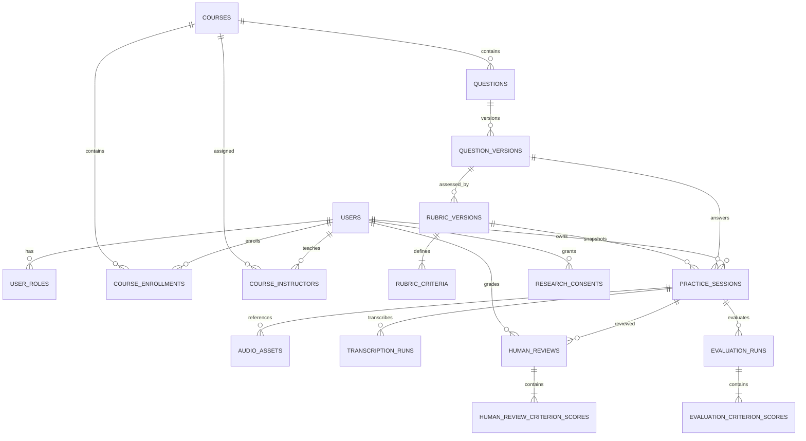

# Đề xuất schema PostgreSQL

> Tài liệu thiết kế sơ bộ cho dự án **AI Oral Exam Practice**. Đây là đề xuất để nhóm thống nhất trước khi tạo migration và entity; chưa phải schema đã triển khai.

## 1. Khảo sát hiện trạng

Dự án gồm Angular frontend, Spring Boot backend và FastAPI AI service. Spring Boot là API nghiệp vụ duy nhất mà frontend gọi; AI service được backend gọi nội bộ. Tài liệu backlog mô tả luồng MVP gồm:

1. Giảng viên quản lý học phần, câu hỏi, đáp án tham chiếu và rubric.
2. Sinh viên chọn câu hỏi, tạo phiên luyện tập và gửi audio.
3. AI tạo transcript; sinh viên xem, sửa và xác nhận transcript.
4. AI chấm theo rubric; sinh viên xem kết quả và lịch sử.
5. Giảng viên chấm một số mẫu để đối chiếu với điểm AI phục vụ nghiên cứu.

Frontend hiện có model cho `User`, `Course`, `Question`, `Rubric`, `PracticeSession` và `Evaluation`. Kế hoạch nghiên cứu yêu cầu lưu phiên bản rubric, cấu hình/version AI, transcript và kết quả đối chiếu.

Backend hiện mới có health endpoint. Trong `pom.xml`, JPA đang bị comment; driver hiện có là MySQL và SQL Server. Chưa có cấu hình PostgreSQL hay migration. Khi triển khai đề xuất này, cần chuyển backend sang PostgreSQL và quản lý schema bằng migration.

## 2. Mục tiêu thiết kế

- Lưu dữ liệu nghiệp vụ và lịch sử luyện tập tại Spring Boot; AI service không phải nguồn dữ liệu chuẩn.
- Giữ nguyên rubric và câu hỏi đã được dùng để kết quả cũ có thể giải thích, tái lập.
- Lưu các lần chạy STT/chấm riêng để retry không ghi đè kết quả cũ.
- Hỗ trợ phân quyền theo người dùng, học phần và quyền sở hữu phiên.
- Không lưu audio dạng binary trong PostgreSQL; chỉ lưu metadata và tham chiếu tới object storage riêng tư.
- Cho phép xuất dữ liệu nghiên cứu đã khử định danh và đối chiếu điểm AI với điểm giảng viên.

## 3. ERD khái quát

## 4. Đề xuất các bảng

### 4.1 Tài khoản và học phần

| Bảng | Cột chính | Ghi chú |
|---|---|---|
| `users` | `id UUID PK`, `email`, `full_name`, `password_hash NULL`, `avatar_url NULL`, `is_active`, `created_at`, `updated_at` | Unique email không phân biệt hoa thường. Không lưu mật khẩu thuần. Nếu dùng đăng nhập Google, định danh nhà cung cấp có thể tách thành `user_identities`. |
| `user_roles` | `user_id FK`, `role`, `created_at` | PK `(user_id, role)`. Cho phép một người có nhiều vai trò; không tin role do frontend gửi lên. |
| `courses` | `id UUID PK`, `code`, `name`, `description`, `semester`, `department`, `is_active`, timestamps | MVP có thể xem một bản ghi là một lớp học phần cụ thể trong một học kỳ. |
| `course_enrollments` | `course_id FK`, `student_id FK`, `enrolled_at`, `status` | Unique `(course_id, student_id)`; kiểm soát sinh viên được truy cập học phần. |
| `course_instructors` | `course_id FK`, `instructor_id FK`, `assigned_at` | PK `(course_id, instructor_id)`; hỗ trợ một học phần có nhiều giảng viên. |

Nếu sau này cần quản lý môn học qua nhiều học kỳ, tách `courses` thành `course_catalog` (môn gốc) và `course_offerings` (lớp mở theo kỳ). Chưa cần áp dụng ở MVP nếu mỗi lớp học phần chỉ xuất hiện một lần.

### 4.2 Ngân hàng câu hỏi và rubric

| Bảng | Cột chính | Ghi chú |
|---|---|---|
| `questions` | `id UUID PK`, `course_id FK`, `created_by FK`, `topic`, `is_active`, timestamps | Định danh ổn định của câu hỏi trong ngân hàng. |
| `question_versions` | `id UUID PK`, `question_id FK`, `version_no`, `title`, `prompt`, `reference_answer`, `difficulty`, `time_limit_seconds`, `tags TEXT[]`, `created_by FK`, `created_at` | Unique `(question_id, version_no)`. Nội dung từng version không sửa sau khi đã được sử dụng. |
| `rubric_versions` | `id UUID PK`, `question_version_id FK`, `version_no`, `total_score NUMERIC(6,2)`, `grading_instructions`, `created_by FK`, `created_at` | Unique `(question_version_id, version_no)`. Một lần cập nhật rubric tạo version mới. |
| `rubric_criteria` | `id UUID PK`, `rubric_version_id FK`, `position`, `name`, `description`, `max_score NUMERIC(6,2)` | Unique `(rubric_version_id, position)`. Không sửa tiêu chí của version đã được session tham chiếu. |

`total_score` nên bằng tổng `max_score` của các tiêu chí. PostgreSQL `CHECK` không thể kiểm tra tổng trên nhiều hàng; validate trong một transaction ở backend hoặc dùng trigger nếu cần bảo vệ ở tầng DB.

### 4.3 Phiên luyện tập, audio và transcript

| Bảng | Cột chính | Ghi chú |
|---|---|---|
| `practice_sessions` | `id UUID PK`, `student_id FK`, `question_version_id FK`, `rubric_version_id FK`, `status`, `transcript_text`, `transcript_confirmed_at`, `created_at`, `updated_at`, `completed_at NULL` | Giữ tham chiếu chính xác tới nội dung được dùng. Trạng thái theo luồng: `draft`, `recording`, `uploaded`, `transcribing`, `transcript_review`, `grading`, `completed`, `transcription_failed`, `grading_failed`, `cancelled`. |
| `audio_assets` | `id UUID PK`, `session_id FK`, `object_key`, `mime_type`, `size_bytes`, `duration_seconds`, `sha256`, `uploaded_at`, `expires_at`, `deleted_at NULL` | File nằm trong private object storage. `object_key` không được phục vụ công khai. Cho phép nhiều lần ghi âm/upload cho một session. |
| `transcription_runs` | `id UUID PK`, `session_id FK`, `audio_asset_id FK`, `status`, `provider`, `model_version`, `language`, `raw_transcript`, `processing_ms`, `error_code`, `started_at`, `completed_at` | Mỗi lần thử STT là một hàng mới; `raw_transcript` giữ đầu ra máy, còn `practice_sessions.transcript_text` là bản sinh viên đang chỉnh/xác nhận. |

Nếu cần lưu toàn bộ lịch sử sửa transcript, có thể bổ sung bảng `transcript_revisions` gồm `session_id`, `content`, `source` (`machine`/`student`), `created_by`, `created_at`, `confirmed_at`. Chưa bắt buộc trong MVP.

### 4.4 Kết quả AI và chấm đối chiếu

| Bảng | Cột chính | Ghi chú |
|---|---|---|
| `evaluation_runs` | `id UUID PK`, `session_id FK`, `rubric_version_id FK`, `status`, `provider`, `model_version`, `prompt_version`, `total_score NUMERIC(6,2)`, `max_score NUMERIC(6,2)`, `strengths JSONB`, `improvements JSONB`, `uncertainty_notes JSONB`, `needs_human_review`, `processing_ms`, `error_code`, `created_at`, `completed_at` | Lưu model/prompt/rubric dùng cho lần chấm. Retry tạo run mới. Có thể thêm `input_transcript_hash` để ghi lại transcript đầu vào mà không nhân đôi nội dung nhạy cảm. |
| `evaluation_criterion_scores` | `id UUID PK`, `evaluation_run_id FK`, `rubric_criterion_id FK`, `score NUMERIC(6,2)`, `max_score NUMERIC(6,2)`, `evidence`, `feedback`, `missing_or_incorrect JSONB` | Unique `(evaluation_run_id, rubric_criterion_id)`. Dữ liệu điểm theo từng tiêu chí được chuẩn hóa để dễ truy vấn và phân tích. |
| `human_reviews` | `id UUID PK`, `session_id FK`, `reviewer_id FK`, `rubric_version_id FK`, `total_score NUMERIC(6,2)`, `notes`, `created_at` | Có thể lưu nhiều lượt chấm độc lập trên cùng session. |
| `human_review_criterion_scores` | `id UUID PK`, `human_review_id FK`, `rubric_criterion_id FK`, `score NUMERIC(6,2)`, `comment` | Unique `(human_review_id, rubric_criterion_id)`; dùng so sánh AI/giảng viên cùng rubric version. |

### 4.5 Đồng ý tham gia nghiên cứu

| Bảng | Cột chính | Ghi chú |
|---|---|---|
| `research_consents` | `id UUID PK`, `user_id FK`, `purpose`, `consent_version`, `status`, `granted_at`, `revoked_at NULL` | Lưu dấu vết đồng ý/thu hồi theo mục đích và phiên bản nội dung. Không coi việc dùng app là đồng ý cho nghiên cứu. |

Khi xuất dữ liệu nghiên cứu, tạo participant code giả danh; không dùng email hoặc hash email làm mã nghiên cứu. Chỉ xuất audio/transcript nếu phạm vi đồng ý cho phép.

## 5. Kiểu dữ liệu và ràng buộc PostgreSQL

- Khóa chính: `UUID` (`gen_random_uuid()` hoặc sinh từ ứng dụng).
- Thời gian: `TIMESTAMPTZ`, lưu UTC và đổi múi giờ khi hiển thị.
- Điểm số: `NUMERIC(6,2)`, tránh `FLOAT` cho điểm cần so sánh chính xác.
- Feedback có cấu trúc nhỏ: `JSONB`; cột thường xuyên lọc, join hoặc thống kê như điểm và tiêu chí nên là cột/bảng quan hệ.
- Tags: MVP dùng `TEXT[]`; nếu cần quản lý từ điển tag và lọc phức tạp, chuyển thành `tags` và `question_version_tags`.
- Email: tạo unique index trên `lower(email)` thay vì phụ thuộc extension `citext`.
- Trạng thái: dùng `CHECK` constraint hoặc PostgreSQL enum. Với trạng thái nghiệp vụ có thể thay đổi theo phiên bản, `CHECK` dễ cập nhật qua migration hơn.
- Điểm phải nằm trong khoảng `0 <= score <= max_score`; kiểm tra tổng điểm run không vượt tổng rubric trong backend transaction.

## 6. Index và quy tắc xóa

Index tối thiểu nên có:

- `users (lower(email))` unique.
- `course_enrollments (student_id, course_id)` và `course_instructors (instructor_id, course_id)`.
- `questions (course_id, is_active)`.
- `question_versions (question_id, version_no)` unique.
- `practice_sessions (student_id, created_at DESC)` cho lịch sử sinh viên.
- `practice_sessions (status, updated_at)` cho job/pipeline đang xử lý.
- `transcription_runs (session_id, created_at DESC)` và `evaluation_runs (session_id, created_at DESC)`.
- Các bảng điểm có index theo `evaluation_run_id`/`human_review_id` và `rubric_criterion_id`.

Không cascade xóa tài khoản/học phần/câu hỏi đã được session tham chiếu. Dùng soft-delete hoặc trạng thái `is_active`; dữ liệu lịch sử phải còn đọc được. Xóa audio theo `expires_at` bằng tác vụ nền, cập nhật `deleted_at` sau khi object storage xác nhận xóa thành công.

## 7. Phạm vi triển khai theo giai đoạn

### MVP dữ liệu nghiệp vụ

`users`, `user_roles`, `courses`, `course_enrollments`, `course_instructors`, `questions`, `question_versions`, `rubric_versions`, `rubric_criteria`, `practice_sessions`, `audio_assets`, `transcription_runs`, `evaluation_runs`, `evaluation_criterion_scores`.

### Bổ sung cho nghiên cứu

`research_consents`, `human_reviews`, `human_review_criterion_scores`; cân nhắc `transcript_revisions` nếu cần tái lập quá trình người học chỉnh transcript.

## 8. Đề xuất triển khai backend

1. Dùng PostgreSQL làm nguồn dữ liệu chuẩn của Spring Boot; FastAPI chỉ nhận nội dung/audio theo yêu cầu xử lý và trả kết quả.
2. Thêm PostgreSQL JDBC driver và Spring Data JPA; bỏ driver MySQL/SQL Server nếu không còn mục tiêu hỗ trợ chúng.
3. Thêm Flyway và tạo migration theo thứ tự phụ thuộc, bắt đầu từ user/course rồi tới question/rubric/session, cuối cùng là các bảng run/score.
4. Để `spring.jpa.hibernate.ddl-auto=validate` ở môi trường ứng dụng; không dùng `create`/`update` làm quản lý schema lâu dài.
5. Cấu hình kết nối qua biến môi trường; không commit mật khẩu DB, Google secret, audio thật hoặc dữ liệu định danh.
6. Thực thi phân quyền ở API backend. Route guard Angular chỉ hỗ trợ trải nghiệm, không phải ranh giới bảo mật.

## 9. Tài liệu trong repo dùng làm căn cứ

- [README.md](../README.md): ranh giới Angular, Spring Boot, FastAPI và trạng thái health-only hiện tại.
- [Product backlog](../plan/PRODUCT_BACKLOG.md): user story, version rubric, audio, transcript, AI evaluation và human review.
- [Kế hoạch nghiên cứu](../KE_HOACH_DO_AN_NCKH.md): luồng dữ liệu, quyền riêng tư, nghiên cứu và lưu phiên bản.
- [Model frontend](../frontend/src/app/shared/models/index.ts): hình dạng hiện tại của course/question/rubric/session/evaluation.
