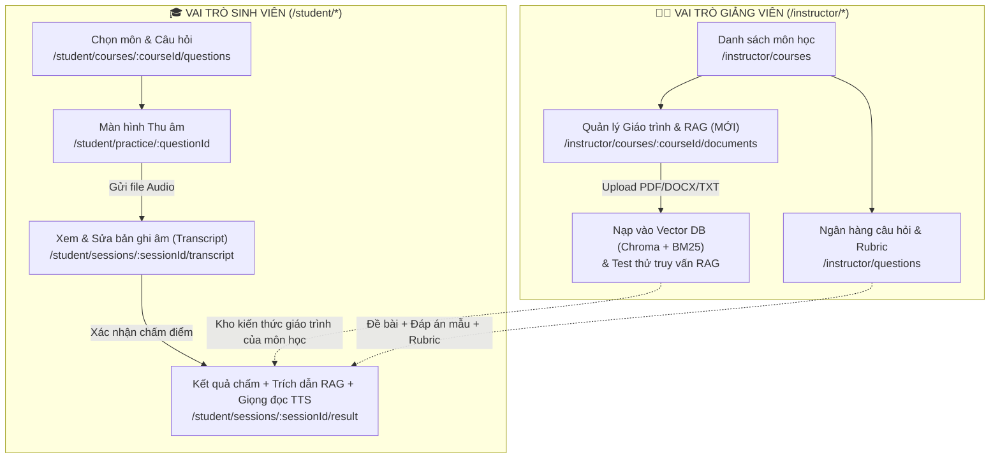

# Kế Hoạch Thiết Kế Giao Diện (UI) Theo Vai Trò Cho Luồng Vấn Đáp AI & Hybrid RAG

> **Mục tiêu tài liệu:** Trong bản demo `speed-to-text-demo` (Gradio), tất cả chức năng từ **tải giáo trình RAG**, **chọn câu hỏi**, **thu âm**, **chấm điểm** đến **chỉnh tham số AI** đều nằm chung trên **1 màn hình duy nhất**. Khi đưa vào dự án thực tế `ai-oral-exam-practice` (Angular + Spring Boot + FastAPI), chúng ta phải **tách bạch rõ ràng theo 3 vai trò (`Instructor`, `Student`, `Admin`)** để đúng nghiệp vụ thực tế, bảo mật và dễ sử dụng.
>
> Tài liệu này quy định chi tiết: **Ai được làm gì trên giao diện nào, thêm màn hình gì, luồng bấm nút ra sao, và phân chia công việc cụ thể cho từng thành viên.**

---

## 1. Bảng Đối Chiếu: Từ Bản Demo Sang 3 Vai Trò Trên Web Thực Tế

| Chức năng trên bản Demo (`speed-to-text-demo`) | Vai trò được phép dùng | Đường dẫn màn hình (Angular Route) | Giải thích ngắn gọn |
| :--- | :---: | :--- | :--- |
| **1. Tải tài liệu giáo trình (`.pdf`, `.docx`, `.txt`) & Bấm "Nạp RAG"** | **Giảng viên** (`instructor`) | `/instructor/courses/:courseId/documents` *(Màn hình mới)* | Chỉ Giảng viên mới được nạp giáo trình chuẩn của môn học để AI làm căn cứ chấm thi. Sinh viên không được tự nạp tài liệu để tránh gian lận. |
| **2. Xem thống kê kho RAG & Tìm kiếm thử trong giáo trình** | **Giảng viên** (`instructor`) | `/instructor/courses/:courseId/documents` *(Màn hình mới)* | Giảng viên kiểm tra xem giáo trình đã tách được bao nhiêu đoạn (chunks) và gõ thử câu hỏi xem AI tìm có chuẩn không. |
| **3. Soạn câu hỏi, đáp án chuẩn & Bảng tiêu chí chấm (Rubric)** | **Giảng viên** (`instructor`) | `/instructor/questions/new`<br>`/instructor/questions/:id/edit`<br>`/instructor/questions/:id/rubric` | Thay vì chọn câu hỏi cố định trong file code như demo, Giảng viên tự thêm/sửa câu hỏi và chia thang điểm từng ý trên web. |
| **4. Chọn môn học & Chọn câu hỏi để vào thi thử** | **Sinh viên** (`student`) | `/student/courses`<br>`/student/courses/:courseId/questions` | Sinh viên chọn môn, xem danh sách câu hỏi và bấm **"Bắt đầu luyện tập"**. |
| **5. Thu âm câu trả lời (hoặc tải file âm thanh)** | **Sinh viên** (`student`) | `/student/practice/:questionId` | Sinh viên nhìn đề bài trên màn hình, bấm nút Micro để nói và nộp bài thu âm. |
| **6. Xem văn bản AI nghe được (Transcript) & Sửa lỗi từ chuyên ngành** | **Sinh viên** (`student`) | `/student/sessions/:sessionId/transcript` | Sau khi AI chuyển giọng nói thành chữ (và tự sửa lỗi từ IT như `vê đê đê` $\rightarrow$ `VDD`), sinh viên được đọc lại, sửa từ bị nghe nhầm rồi mới bấm **"Gửi chấm điểm"**. |
| **7. Xem bảng điểm từng tiêu chí, trích dẫn giáo trình (RAG) & Nghe giọng đọc nhận xét (TTS)** | **Sinh viên** (`student`) | `/student/sessions/:sessionId/result` | Sinh viên xem điểm tổng, điểm từng ý, đọc đoạn giáo trình mà AI trích ra để đối chiếu, và bấm nút Loa để nghe AI đọc lời khuyên. |
| **8. Đổi Model AI (`Groq`/`Gemini`), chọn thuật toán RAG (`Hybrid` + `Rerank`), quản lý API Key** | **Quản trị viên** (`admin`) / Cấu hình hệ thống | `/admin/dashboard` *(hoặc cấu hình trong `.env` ở MVP)* | Sinh viên và Giảng viên không cần biết đến các thông số kỹ thuật này. Hệ thống mặc định chạy cấu hình tốt nhất (`Hybrid RAG` + `Groq/Gemini`). |

---

## 2. Sơ Đồ Luồng Giao Diện Theo Vai Trò



---

## 3. Thiết Kế Chi Tiết Từng Màn Hình (Theo Vai Trò)

> [!IMPORTANT]
> **Quy tắc giao diện bắt buộc (theo [`QUY_TAC_THIET_KE_FE.md`](file:///d:/ai-oral-exam-practice/QUY_TAC_THIET_KE_FE.md)):**
> - **100% dùng file `.css` thuần** (tuyệt đối không tạo file `.scss`).
> - Tái sử dụng hệ biến màu trong [`styles.css`](file:///d:/ai-oral-exam-practice/frontend/src/styles.css) (`--color-primary`, `--color-bg-card`, `--color-border`, v.v.).
> - Mọi màn hình gọi API phải có đủ **4 trạng thái**: Đang tải (`loading`), Chưa có dữ liệu (`empty`), Lỗi (`error`), và Thành công (`success`).

---

### PHẦN A: GIAO DIỆN CỦA GIẢNG VIÊN (`Instructor`)

#### Màn hình A1: Quản lý Giáo trình & Kho kiến thức RAG (Màn hình mới cần thêm)
- **Đường dẫn (Route):** `/instructor/courses/:courseId/documents`
- **Cách đi vào:** Từ màn hình danh sách môn học (`/instructor/courses`), trên mỗi thẻ môn học có thêm nút **"📚 Giáo trình RAG"** (hoặc tab bên trong chi tiết môn học).
- **Bố cục màn hình gồm 3 khu vực rõ ràng:**
  1. **Khu vực 1 — Tải tài liệu giáo trình lên (Upload Box):**
     - Khung kéo thả (Drag & Drop) hoặc chọn file từ máy tính, hỗ trợ `.pdf`, `.docx`, `.txt`.
     - Nút bấm chính: **"📥 Tải lên & Nạp vào kho AI (RAG)"**.
     - Khi đang xử lý: Hiện thanh trạng thái *"Đang đọc tài liệu, chia đoạn văn bản và tạo chỉ mục tìm kiếm..."* (`loading`).
  2. **Khu vực 2 — Danh sách tài liệu đã nạp & Thống kê:**
     - Thẻ tóm tắt: **Tổng số file đã nạp** | **Tổng số đoạn văn bản (chunks) trong kho** | **Trạng thái đồng bộ** (`Đã sẵn sàng`).
     - Bảng danh sách các file giáo trình của môn học: Tên file, ngày tải lên, số đoạn văn bản (chunks) được tách ra từ file đó, nút **"🗑️ Xóa tài liệu"** (xóa luôn các đoạn văn bản tương ứng trong ChromaDB/BM25).
  3. **Khu vực 3 — Khung kiểm tra thử RAG (Test Search Box):**
     - Ô nhập văn bản: *"Nhập thử một câu hỏi hoặc câu trả lời của sinh viên để xem AI tìm được đoạn nào trong giáo trình..."*
     - Nút **"🔍 Tìm thử"**.
     - Kết quả trả về bên dưới: Hiển thị 3 đoạn trích dẫn sát nhất kèm tên file nguồn và điểm độ khớp (RRF Score) để Giảng viên yên tâm là AI đã hiểu giáo trình.
- **API kết nối:**
  - `POST /api/courses/{courseId}/documents` (Spring Boot lưu file $\rightarrow$ gọi sang FastAPI `POST /ai/rag/ingest` kèm `course_id`).
  - `GET /api/courses/{courseId}/documents` (Lấy danh sách tài liệu và số lượng chunks).
  - `POST /api/courses/{courseId}/rag-search` (Spring Boot chuyển tiếp sang FastAPI `POST /ai/rag/search` để Giảng viên test thử).

#### Màn hình A2: Soạn Câu hỏi, Đáp án chuẩn & Tiêu chí chấm (Rubric)
- **Đường dẫn (Route):** `/instructor/questions/new`, `/instructor/questions/:questionId/edit`, `/instructor/questions/:questionId/rubric` (Đã có sẵn khung route trong [`app.routes.ts`](file:///d:/ai-oral-exam-practice/frontend/src/app/app.routes.ts)).
- **Những gì Giảng viên nhập trên màn hình này (sẽ gửi cho AI lúc chấm):**
  - **Nội dung câu hỏi** (`content`): Câu hỏi hiển thị cho sinh viên.
  - **Đáp án chuẩn / Ý chính cần có** (`referenceAnswer`): Dùng làm chuẩn đối chiếu chính khi chấm.
  - **Danh sách tiêu chí chấm (Rubric):** Ví dụ:
    - *Ý 1: Nêu đúng định nghĩa (40% trọng số)*
    - *Ý 2: Giải thích được nguyên lý hoạt động (40% trọng số)*
    - *Ý 3: Nêu được ví dụ thực tế (20% trọng số)*

---

### PHẦN B: GIAO DIỆN CỦA SINH VIÊN (`Student`)

Toàn bộ quy trình 5 bước của `speed-to-text-demo` được chia thành **3 màn hình nối tiếp nhau** theo từng bước rõ ràng để sinh viên không bị rối:

#### Màn hình B1: Thu âm câu trả lời (Bước 1)
- **Đường dẫn (Route):** `/student/practice/:questionId`
- **Những gì hiển thị trên màn hình:**
  1. **Thẻ Đề bài:** Hiển thị rõ câu hỏi, tên môn học, độ khó và gợi ý thời gian trả lời (ví dụ: 1 – 3 phút).
  2. **Bộ điều khiển Thu âm:**
     - Nút bấm lớn ở giữa: **"🎙️ Bắt đầu thu âm"** $\rightarrow$ Khi đang thu đổi thành **"⏹️ Dừng thu âm"** kèm đồng hồ đếm giây (`00:45`) và hiệu ứng sóng âm.
     - Trình phát nghe lại (Audio Player) sau khi bấm dừng để sinh viên tự nghe lại giọng mình.
     - Nút phụ: **"📂 Hoặc tải file âm thanh có sẵn (.wav, .mp3, .webm)"** (rất hữu ích khi máy bàn không có micro hoặc khi nhóm test dự án).
  3. **Nút hành động chính:** **"📤 Nộp âm thanh & Chuyển thành văn bản"**
     - Khi bấm: Gửi file audio lên Backend $\rightarrow$ Backend gọi `POST /ai/stt` (chạy STT + tự động sửa lỗi thuật ngữ chuyên ngành bằng AI) $\rightarrow$ Chuyển hướng sang Màn hình B2.

#### Màn hình B2: Xem lại & Chỉnh sửa văn bản ghi âm (Bước 2)
- **Đường dẫn (Route):** `/student/sessions/:sessionId/transcript`
- **Tại sao cần màn hình này?** Trong thi vấn đáp, đôi khi môi trường ồn hoặc sinh viên phát âm thuật ngữ tiếng Anh (như `Thread`, `Process`, `Deadlock`, `TCP/IP`) khiến STT nghe nhầm. Dù AI đã hỗ trợ sửa lỗi bước 1 (`correct_transcript_with_gemini`), việc cho sinh viên đọc lại và tự sửa 1 lần nữa giúp kết quả chấm công bằng 100%.
- **Những gì hiển thị trên màn hình:**
  1. **Đề bài câu hỏi** (thu gọn ở phía trên để tiện đối chiếu).
  2. **Trình phát lại file ghi âm vừa nói** (để sinh viên vừa nghe lại vừa dò chữ).
  3. **Ô văn bản có thể chỉnh sửa (`<textarea>`):**
     - Mặc định điền sẵn văn bản đã được AI chuẩn hóa thuật ngữ (`correctedTranscript`).
     - Có nút nhỏ **"Xem bản gốc chưa qua AI sửa lỗi"** nếu sinh viên muốn so sánh.
  4. **Nút hành động chính:** **"✅ Xác nhận nội dung & Chấm điểm ngay"**
     - Khi bấm: Hiện trạng thái chờ *"AI đang tra cứu giáo trình môn học (Hybrid RAG) và chấm điểm theo từng tiêu chí..."* $\rightarrow$ Xong thì chuyển sang Màn hình B3.

#### Màn hình B3: Kết quả chấm điểm, Trích dẫn giáo trình RAG & Nghe nhận xét (Bước 3, 4, 5)
- **Đường dẫn (Route):** `/student/sessions/:sessionId/result`
- **Những gì hiển thị trên màn hình (Chia làm 4 khối trực quan):**
  1. **Khối 1 — Tổng điểm & Trình phát giọng nói nhận xét (TTS Audio):**
     - Vòng tròn hoặc thẻ điểm tổng (ví dụ: **`8.2 / 10`** — Xếp loại: **Khá Giỏi**).
     - **Khung nghe nhận xét bằng giọng nói (TTS):** Có thanh phát âm thanh (Play/Pause) phát file giọng đọc Tiếng Việt từ `POST /ai/tts` kèm lời nhận xét tổng quan, khích lệ của AI.
  2. **Khối 2 — Bảng điểm chi tiết theo từng tiêu chí (Rubric Breakdown):**
     - Hiển thị từng tiêu chí mà Giảng viên đã đặt ra (ví dụ: *Định nghĩa: 3.5/4.0đ*, *Nguyên lý: 3.2/4.0đ*, *Ví dụ: 1.5/2.0đ*) kèm thanh tiến độ màu xanh/vàng/đỏ và giải thích ngắn gọn vì sao đạt mức điểm đó.
  3. **Khối 3 — Điểm mạnh, Điểm thiếu & Câu trả lời mẫu gợi ý:**
     - **✅ Ý bạn đã nêu đúng:** Danh sách gạch đầu dòng các ý đúng trong bài nói.
     - **⚠️ Ý còn thiếu hoặc nói sai:** Chỉ rõ chỗ sai so với giáo trình.
     - **💡 Gợi ý cách trả lời đạt điểm tối đa:** Đoạn văn mẫu ngắn gọn, súc tích để sinh viên học theo.
  4. **Khối 4 — Dẫn chứng từ Giáo trình môn học (RAG Citations):**
     - Hộp thông tin mở rộng (Accordion / Card): *"📖 Các đoạn giáo trình liên quan được AI dùng để chấm câu này"*.
     - Hiển thị 2–3 đoạn trích từ tài liệu mà Giảng viên đã nạp, kèm tên file giáo trình để sinh viên biết cần đọc lại trang nào/phần nào.
  5. **Nút điều hướng cuối trang:**
     - **"🔄 Luyện tập lại câu này"** | **"➡️ Câu hỏi tiếp theo"** | **"📜 Xem lịch sử luyện tập"** (`/student/history`).

---

### PHẦN C: GIAO DIỆN CỦA QUẢN TRỊ VIÊN (`Admin`)

- **Đường dẫn (Route):** `/admin/dashboard`
- **Quyết định thiết kế cho đồ án (MVP):**
  - Không bê các thanh trượt kỹ thuật phức tạp (`Top-K`, `RRF k=60`, ô nhập `API Key` trực tiếp) lên giao diện người dùng cuối. Mọi cấu hình chuẩn được lưu an toàn trong file `.env` của `ai-service`.
  - Trên trang `/admin/dashboard`, chỉ cần hiển thị **Thẻ trạng thái hệ thống AI (AI Health Check)** gọi tới `GET /ai/health`:
    - Trạng thái kết nối `ai-service`: **Đang hoạt động (Online)** / **Mất kết nối (Offline)**.
    - Nhà cung cấp STT/LLM đang kích hoạt: Ví dụ `Groq (whisper-large-v3 + llama-3.3-70b)`.
    - Tổng số tài liệu / đoạn văn bản đang có trong ChromaDB.

---

## 4. Tổng Hợp Thay Đổi Trong Cấu Trúc Thư Mục Frontend (`frontend/src/app/`)

Để thực hiện đầy đủ các màn hình trên, cấu trúc `frontend/src/app/` sẽ cập nhật như sau:

```text
frontend/src/app/
├── app.routes.ts                                      # Thêm route /instructor/courses/:courseId/documents
├── core/
│   ├── models/
│   │   ├── rag-document.model.ts                      # [MỚI] Kiểu dữ liệu tài liệu giáo trình & kết quả tìm thử RAG
│   │   └── evaluation-result.model.ts                 # [CẬP NHẬT] Thêm trường ragCitations, ttsAudioUrl, correctedTranscript
│   └── services/
│       ├── rag-document.service.ts                    # [MỚI] Gọi API tải giáo trình, xóa giáo trình, test tìm kiếm RAG
│       └── session.service.ts                         # [CẬP NHẬT] Gọi API thu âm -> sửa transcript -> chấm điểm RAG + TTS
└── features/
    ├── instructor/
    │   └── course-documents/                          # [MỚI] Màn hình A1: Upload giáo trình & quản lý kho RAG theo môn
    │       ├── course-documents.component.ts
    │       ├── course-documents.component.html
    │       └── course-documents.component.css         # Chỉ dùng .css thuần!
    └── student/
        ├── practice-recorder/                         # [HOÀN THIỆN] Màn hình B1: Thu âm / Upload file âm thanh
        ├── transcript-review/                         # [HOÀN THIỆN] Màn hình B2: Nghe lại & sửa bản chữ (Transcript)
        └── session-result/                            # [HOÀN THIỆN] Màn hình B3: Bảng điểm Rubric + Trích dẫn RAG + Loa TTS
```

---

## 5. Phân Chia Công Việc Cụ Thể Cho Từng Thành Viên (Ai Làm Gì?)

Cách chia dưới đây khớp 100% với phân công **5 thành viên (`TV1` – `TV5`)** trong [`TIEN_DO_VA_VIEC_TIEP_THEO.md`](file:///d:/ai-oral-exam-practice/plan/TIEN_DO_VA_VIEC_TIEP_THEO.md), viết rõ ràng để ai đọc cũng biết ngay việc của mình:

### 🧑‍🔬 TV1 (Phụ trách Dữ liệu học thuật, Giáo trình mẫu & Nghiên cứu đánh giá)
1. **Chuẩn bị bộ giáo trình chuẩn cho RAG (`.pdf`, `.docx`, `.txt`):**
   - Thu thập và làm sạch giáo trình / bài giảng của 1–2 học phần để nạp vào kho RAG; kiểm tra xem khi tách đoạn (chunks 600 ký tự) có bị lỗi font tiếng Việt hay đứt câu không.
2. **Tổng hợp từ điển thuật ngữ chuyên ngành & bộ câu hỏi/Rubric mẫu:**
   - Liệt kê các thuật ngữ tiếng Anh chuyên ngành hay bị đọc nhầm (như `Thread`, `Process`, `Deadlock`, `TCP/IP`, `VDD`...) để cung cấp cho bước sửa lỗi Transcript của `TV4`.
   - Rà soát độ khớp giữa đoạn trích dẫn RAG (`ragCitations`) với đáp án chuẩn trên giao diện kết quả.

### 👩‍💻 TV2 (Phụ trách Giao diện chính — Angular, đặc biệt là Luồng Sinh viên)
1. **Làm Màn hình Thu âm (`/student/practice/:questionId`):**
   - Nút bấm Micro ghi âm trên trình duyệt (`MediaRecorder`), đồng hồ đếm giờ, nghe lại trước khi nộp và nút tải file âm thanh có sẵn lên.
2. **Làm Màn hình Xem & Sửa bản ghi âm (`/student/sessions/:sessionId/transcript`):**
   - Hiển thị văn bản đã được AI sửa lỗi thuật ngữ trong ô `<textarea>` để sinh viên kiểm tra lại lần cuối trước khi bấm gửi chấm điểm.
3. **Làm Màn hình Kết quả (`/student/sessions/:sessionId/result`):**
   - Hiển thị điểm tổng, bảng điểm từng tiêu chí Rubric, danh sách ý đúng/ý thiếu, **khung trích dẫn giáo trình (RAG Citations)** và **nút bấm Loa nghe AI đọc nhận xét (TTS)**.

### 👨‍💻 TV3 (Phụ trách Backend — Java Spring Boot & Cơ sở dữ liệu)
1. **Làm API cho Giảng viên quản lý giáo trình RAG:**
   - Tạo bảng `course_documents` trong MySQL (lưu tên file, `course_id`, số lượng chunks, người tải lên, thời gian).
   - Viết API `POST /api/courses/{courseId}/documents`, `GET /api/courses/{courseId}/documents`, `DELETE /api/courses/{courseId}/documents/{docId}` và `POST /api/courses/{courseId}/rag-search` (chặn chặt chỉ cho phép vai trò `INSTRUCTOR` hoặc `ADMIN`).
2. **Cập nhật API luồng làm bài của Sinh viên:**
   - Khi sinh viên nộp file ghi âm (`POST /api/sessions/{id}/audio`), gọi sang `/ai/stt` và lưu cả bản gốc lẫn bản đã sửa lỗi thuật ngữ.
   - Khi sinh viên bấm chấm điểm (`POST /api/sessions/{id}/evaluate`), gửi kèm `courseId`, câu hỏi, đáp án chuẩn, Rubric sang `/ai/evaluate` và `/ai/tts`, rồi lưu điểm số + trích dẫn RAG + đường dẫn file giọng đọc TTS vào Database.

### 👨‍💻 TV4 (Phụ trách AI Service — Python FastAPI)
1. **Đưa bộ máy Hybrid RAG & Chấm điểm từ `speed-to-text-demo` sang `ai-service`:**
   - Gắn biến `course_id` vào metadata của ChromaDB và BM25 để giáo trình môn nào chỉ tìm trong môn đó.
   - Viết 5 API nội bộ rõ ràng:
     1. `POST /ai/rag/ingest`: Nhận file `.pdf`/`.docx`/`.txt` + `course_id`, tách đoạn và lưu vào kho.
     2. `POST /ai/rag/search`: Tìm thử các đoạn giáo trình khớp nhất theo `course_id` (Hybrid Dense + BM25 + RRF).
     3. `POST /ai/stt`: Nhận file âm thanh $\rightarrow$ trả về văn bản gốc (`raw_transcript`) và văn bản đã sửa lỗi từ chuyên ngành (`corrected_transcript`).
     4. `POST /ai/evaluate`: Nhận câu hỏi + đáp án mẫu + Rubric + văn bản sinh viên nói + `course_id` $\rightarrow$ tra cứu Hybrid RAG $\rightarrow$ chấm điểm JSON và trả kèm các đoạn trích dẫn giáo trình (`rag_citations`).
     5. `POST /ai/tts`: Nhận lời nhận xét tổng quan $\rightarrow$ trả về file âm thanh giọng đọc Tiếng Việt (`edge-tts`).

### 🧑‍💻 TV5 (Phụ trách Ghép nối đầu-cuối, Giao diện Giảng viên/Admin & Kiểm thử)
1. **Làm màn hình Quản lý Giáo trình & RAG cho Giảng viên (`/instructor/courses/:courseId/documents`):**
   - Thêm nút **"📚 Giáo trình RAG"** vào mỗi môn học ở trang `/instructor/courses`.
   - Làm khung kéo thả tải file `.pdf/.docx/.txt`, bảng danh sách tài liệu đã nạp và ô **"Tìm thử trong giáo trình"** cho Giảng viên; thêm thẻ Trạng thái AI trên `/admin/dashboard`.
2. **Kiểm thử phân quyền & ghép nối toàn trình (End-to-End):**
   - Kiểm tra đảm bảo tài khoản `student` không thể vào `/instructor/courses/:courseId/documents` hoặc gọi API nạp/xóa tài liệu RAG.
   - Chạy kiểm thử xuyên suốt từ lúc Giảng viên tải giáo trình $\rightarrow$ Sinh viên thu âm $\rightarrow$ Sửa văn bản $\rightarrow$ Nhận điểm kèm trích dẫn giáo trình và giọng đọc nhận xét.

---

## 6. Thứ Tự Ưu Tiên Triển Khai Trên Giao Diện (Checklist Ngắn Gọn)

- [ ] **Bước 1 (Luồng Giảng viên nạp kiến thức):** Làm xong màn hình `/instructor/courses/:courseId/documents` + API nạp giáo trình vào RAG theo môn học (`TV5` + `TV3` + `TV4`, dữ liệu giáo trình do `TV1` chuẩn bị).
- [ ] **Bước 2 (Luồng Sinh viên thu âm & sửa văn bản):** Làm xong màn hình `/student/practice/:questionId` và `/student/sessions/:sessionId/transcript` kết nối với `/ai/stt` có sửa lỗi thuật ngữ IT (`TV2` + `TV3` + `TV4`).
- [ ] **Bước 3 (Luồng Sinh viên xem điểm + Trích dẫn RAG + Giọng đọc TTS):** Làm xong màn hình `/student/sessions/:sessionId/result` hiển thị đầy đủ điểm Rubric, đoạn trích giáo trình và trình phát âm thanh nhận xét (`TV2` + `TV3` + `TV4`).
- [ ] **Bước 4 (Kiểm thử toàn trình):** Dùng giáo trình thật và câu trả lời ghi âm thật chạy xuyên suốt từ tài khoản Giảng viên sang tài khoản Sinh viên (`Cả nhóm`, `TV1` & `TV5` điều phối).
