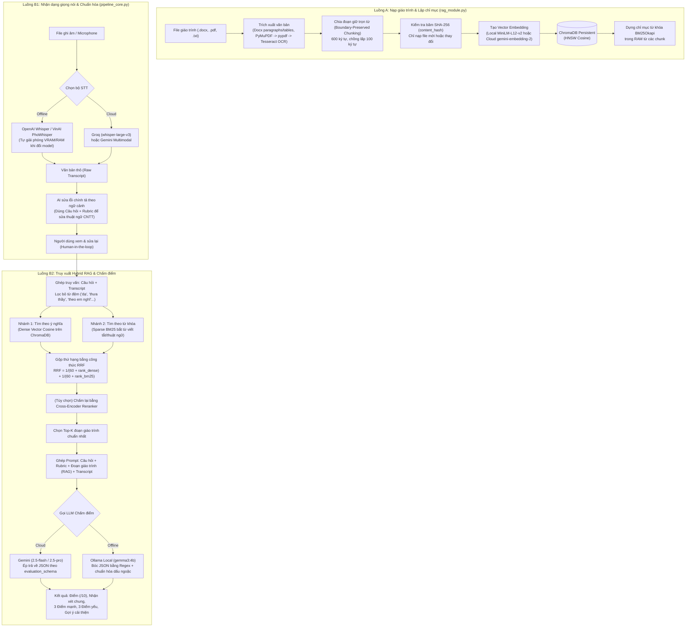

# Phân tích `speed-to-text-demo` và Kế hoạch tích hợp vào `ai-service`

> Tài liệu phân tích chi tiết mã nguồn repo [luannguyenn889/speed-to-text-demo](https://github.com/luannguyenn889/speed-to-text-demo) (QNU AI VIVA) và lộ trình chuyển đổi, nâng cấp để đưa vào thư mục `ai-service/` (FastAPI) của hệ thống **AI Oral Exam Practice**.

---

## Phần 1: Phân tích chi tiết luồng hoạt động của Demo

Repo `speed-to-text-demo` được tổ chức quanh 3 file cốt lõi:
- **`pipeline_core.py`**: Xử lý âm thanh (STT), sửa lỗi chính tả bằng AI theo ngữ cảnh, và gọi LLM chấm điểm.
- **`rag_module.py`**: Quản lý kho tri thức giáo trình, chia đoạn (chunking), tạo vector (embedding) và tìm kiếm lai (Hybrid Search: Dense + BM25 + RRF + Reranker).
- **`app.py`**: Giao diện Gradio điều phối luồng 2 bước (Bước 1: Ký âm & Hiệu đính $\rightarrow$ Bước 2: Truy xuất RAG & Chấm điểm).

### 1.1. Sơ đồ luồng hoạt động tổng thể trong Demo



---

### 1.2. Phân tích sâu cơ chế Hybrid RAG trong `rag_module.py`

Điểm giá trị nhất của bản demo là cách xây dựng **Hybrid RAG hai giai đoạn** giải quyết đúng bài toán đặc thù của thi vấn đáp ngành CNTT:

#### A. Cách nạp và chia nhỏ tài liệu (Ingestion & Chunking)
1. **Đọc đa định dạng có dự phòng (Fallback)**:
   - `.docx`: Đọc toàn bộ đoạn văn (`paragraphs`) và **quét cả các bảng biểu (`tables`)**, nối các ô trên cùng hàng bằng ký tự ` | ` để không mất nội dung bảng so sánh hoặc bảng rubric.
   - `.pdf`: Thử 3 tầng:
     - Tầng 1: `PyMuPDF (fitz)` để lấy văn bản nhanh.
     - Tầng 2: Nếu rỗng, thử `pypdf`.
     - Tầng 3: Nếu là PDF scan (ảnh), tự động render từng trang ra ảnh và gọi `Tesseract OCR` (`vie+eng`).
2. **Chia đoạn bảo toàn biên từ (`chunk_text` & `get_clean_overlap`)**:
   - Kích thước mỗi đoạn mục tiêu: `600` ký tự, phần gối đầu (`overlap`): `100` ký tự.
   - Ưu tiên ngắt theo đoạn văn (`\n`), nếu đoạn văn quá dài mới ngắt theo câu (`.?!`).
   - Khi lấy 100 ký tự cuối để gối sang đoạn tiếp theo, hàm `get_clean_overlap()` tìm khoảng trắng đầu tiên để **không bao giờ cắt đôi một từ tiếng Việt**.
3. **Đồng bộ thông minh bằng mã băm (`index_documents`)**:
   - Tính mã băm `SHA-256` (`content_hash`) cho từng file.
   - Khi quét lại thư mục, file nào không đổi `content_hash` và cùng `embedding_model` sẽ được bỏ qua ngay (không tốn thời gian và quota tạo lại vector). File nào đã xóa khỏi thư mục thì tự động gỡ chunk khỏi ChromaDB.

#### B. Vì sao phải dùng Hybrid (Dense + BM25) cho thi vấn đáp?
- **Nếu chỉ dùng Dense Vector (`paraphrase-multilingual-MiniLM-L12-v2` hoặc `gemini-embedding-2`)**:
  - *Mạnh*: Hiểu được câu trả lời diễn đạt bằng lời văn khác giáo trình (ví dụ sinh viên nói *"kiểm tra xem sản phẩm có đúng thứ khách hàng cần không"* vẫn khớp với đoạn nói về *"Validation"*).
  - *Yếu*: Dễ trượt các từ viết tắt, mã lỗi, tên chuẩn hoặc thuật ngữ ngắn (`SRS`, `SOLID`, `ACID`, `TCP/IP`, `B-Tree`).
- **Nếu chỉ dùng BM25 (`BM25Okapi`)**:
  - *Mạnh*: Bắt trúng ngay các đoạn chứa đúng từ khóa chuyên ngành hoặc từ viết tắt mà sinh viên nhắc tới.
  - *Yếu*: Sinh viên diễn đạt bằng từ đồng nghĩa hoặc STT nghe trệch 1 từ là điểm BM25 giảm mạnh.
- **Giải pháp kết hợp trong demo**:
  1. **Làm sạch câu nói (`clean_oral_query`)**: Xóa các từ cửa miệng khi thi vấn đáp (*"dạ", "thưa thầy", "thưa cô", "em xin phép", "theo em nghĩ", "ừm", "à"*). Bước này rất quan trọng vì từ đệm làm loãng vector ngữ nghĩa và gây nhiễu từ khóa BM25.
  2. **Lấy tập ứng viên rộng (`candidate_pool_size`)**: Với `top_k = 3`, mỗi nhánh lấy trước `max(3 * 3, 8) = 9` đoạn tiềm năng nhất.
  3. **Hợp nhất bằng Reciprocal Rank Fusion (RRF)**:
     Vì điểm Cosine Similarity ($0 \dots 1$) và điểm BM25 ($0 \dots \infty$) không cùng đơn vị đo nên không thể cộng trực tiếp. Demo chuyển sang cộng theo **thứ hạng (rank)**:
     $$\text{RRF\_Score} = \frac{1}{60 + \text{rank}_{\text{dense}}} + \frac{1}{60 + \text{rank}_{\text{bm25}}}$$
     Đoạn giáo trình nào vừa đúng ý nghĩa (hạng Dense cao) vừa chứa đúng thuật ngữ chuyên ngành (hạng BM25 cao) sẽ vươn lên đứng đầu bảng xếp hạng.

---

### 1.3. Phân tích luồng STT, Sửa lỗi chính tả và Chấm điểm trong `pipeline_core.py`

1. **Quản lý bộ nhớ khi chạy STT Local**:
   - Khi chuyển đổi giữa Whisper, PhoWhisper và Cloud STT, hàm `unload_whisper_models()` chủ động xóa model khỏi biến đệm, gọi `gc.collect()` và `torch.cuda.empty_cache()` để tránh tràn VRAM trên máy cá nhân.
2. **Sửa lỗi chính tả có định hướng (`correct_transcript_with_gemini`)**:
   - Điểm rất hay của demo: Không sửa chính tả mù quáng, mà **đưa cả Câu hỏi và Rubric vào prompt sửa lỗi**. Nhờ vậy, khi STT ghi âm nhầm *"tính đa hình trong úp"* hoặc *"lắp trừu tượng"*, AI nhìn vào câu hỏi lập trình hướng đối tượng sẽ sửa chính xác thành *"tính đa hình trong OOP"* và *"lớp trừu tượng"*, đồng thời bị cấm viết lại hay thêm ý hộ sinh viên.
3. **Chấm điểm ép khuôn JSON (`grade_with_gemini`)**:
   - Với Gemini: Dùng `GenerateContentConfig(response_mime_type="application/json", response_schema=evaluation_schema)` để đảm bảo 100% trả về JSON đúng cấu trúc.
   - Với Ollama (`gemma3:4b`): Dùng Regex bóc khối `{...}` và thay thế các dấu ngoặc kép cong (`“ ”`) hay gặp ở model nhỏ thành ngoặc kép chuẩn (`"`) trước khi `json.loads`.

---

## Phần 2: Những điểm cần điều chỉnh khi đưa vào `ai-service` của dự án

Mặc dù thuật toán cốt lõi của bản demo rất tốt, ta **không nên chép nguyên xi** vào dự án vì 5 khác biệt kiến trúc sau:

| Hạng mục | Bản Demo (`speed-to-text-demo`) | Hệ thống của bạn (`ai-oral-exam-practice`) | Cách chuyển đổi |
|---|---|---|---|
| **1. Giao thức** | Chạy giao diện đơn lẻ bằng `Gradio` (`app.py`), dùng biến `global` lưu trạng thái | Microservice `FastAPI` nội bộ, nhận request REST JSON từ `Spring Boot` | Bỏ `Gradio`, bọc các hàm trong `pipeline_core.py` và `rag_module.py` thành các endpoint FastAPI không lưu trạng thái toàn cục (stateless) |
| **2. Quản lý tài liệu theo môn học** | Chung 1 thư mục `document/` cho toàn bộ ứng dụng | Có nhiều học phần (`courses`), mỗi học phần có tài liệu riêng | Gắn `course_id` vào metadata của từng chunk trong ChromaDB; khi chấm câu hỏi thuộc môn nào chỉ tìm trong `course_id` của môn đó |
| **3. Cấu trúc kết quả chấm (Schema)** | Chỉ có 1 điểm tổng (`score`), `summary`, `strengths`, `weaknesses`, `improvement` | Cần chấm **chi tiết từng tiêu chí trong Rubric** (`criteria`: điểm từng ý, bằng chứng trích từ bài nói, ý thiếu/sai), `uncertainty_notes`, `needs_human_review` | Nâng cấp `evaluation_schema` và Prompt chấm điểm trong `pipeline_core.py` để trả về đúng cấu trúc `Evaluation` mà Frontend Angular và DB đang chờ |
| **4. Bảo mật API Key** | Truyền `api_key` từ ô nhập trên giao diện xuống hàm | Không để lộ key ở Frontend hay truyền qua lại mỗi request | Đọc `GEMINI_API_KEY`, `GROQ_API_KEY` trực tiếp từ file `.env` của `ai-service` |
| **5. Tách luồng 2 bước rõ ràng** | Người dùng bấm nút trên Gradio | Bước 1: SV nộp ghi âm $\rightarrow$ nhận transcript (đã sửa lỗi từ chuyên ngành) $\rightarrow$ SV xác nhận. Bước 2: Gửi transcript đã xác nhận $\rightarrow$ RAG + Chấm điểm | Xây dựng 3 nhóm API riêng biệt trên FastAPI: `/ai/transcriptions`, `/ai/evaluations`, và `/ai/rag/documents` |

---

## Phần 3: Kế hoạch triển khai vào `ai-service`

### 3.1. Cấu trúc thư mục `ai-service/` đề xuất

```text
ai-service/
├── app/
│   ├── main.py                 # Khởi tạo FastAPI, gắn các router và quản lý vòng đời (lifespan)
│   ├── config.py               # Đọc cấu hình từ .env (API keys, model mặc định, đường dẫn lưu trữ)
│   ├── schemas/                # Định nghĩa dữ liệu đầu vào / đầu ra (Pydantic models)
│   │   ├── stt_schema.py       # Request/Response cho nhận dạng giọng nói & sửa chính tả
│   │   ├── eval_schema.py      # Request/Response cho chấm điểm theo Rubric + trích dẫn RAG
│   │   └── rag_schema.py       # Request/Response cho nạp tài liệu và tra cứu thử
│   ├── services/
│   │   ├── stt_service.py      # Chuyển từ pipeline_core.py (Groq, Gemini, Whisper, PhoWhisper + sửa lỗi CNTT)
│   │   ├── rag_service.py      # Chuyển từ rag_module.py (Chunking, ChromaDB, BM25, RRF, lọc theo course_id)
│   │   └── grading_service.py  # Chuyển từ pipeline_core.py (Ghép RAG context + chấm từng tiêu chí Rubric)
│   └── routers/
│       ├── transcriptions.py   # POST /ai/transcriptions
│       ├── evaluations.py      # POST /ai/evaluations
│       └── rag.py              # POST /ai/rag/index, POST /ai/rag/search, GET /ai/rag/status
├── data/
│   ├── documents/              # Thư mục chứa giáo trình phân theo từng môn: data/documents/{course_id}/
│   └── chroma_db/              # Nơi lưu trữ Vector DB cục bộ
├── .env.example
└── pyproject.toml
```

---

### 3.2. Thiết kế hợp đồng API (API Contract giữa Spring Boot và FastAPI)

#### API 1: Chuyển giọng nói thành chữ + Sửa lỗi thuật ngữ (`POST /ai/transcriptions`)
- **Khi nào gọi:** Khi sinh viên gửi file ghi âm lên Spring Boot, Spring Boot gọi sang FastAPI.
- **Đầu vào (Request):**
  ```json
  {
    "audio_path": "/duong/dan/file/ghi_am.webm",
    "question_text": "Trình bày 4 tính chất của lập trình hướng đối tượng (OOP).",
    "rubric_summary": "Đóng gói, Kế thừa, Đa hình, Trừu tượng",
    "stt_provider": "groq",
    "enable_spell_correction": true
  }
  ```
  *(Hỗ trợ cả gửi đường dẫn file nội bộ hoặc upload `multipart/form-data`)*.
- **Đầu ra (Response):**
  ```json
  {
    "raw_transcript": "bốn tính chất của úp là đóng gói kế thừa đa hình và chư tượng",
    "corrected_transcript": "Bốn tính chất của OOP là đóng gói, kế thừa, đa hình và trừu tượng.",
    "duration_seconds": 45.2,
    "stt_model": "whisper-large-v3 (groq)",
    "correction_model": "gemini-2.5-flash",
    "processing_time_ms": 1850
  }
  ```
  *(Spring Boot lưu cả `raw_transcript` để phục vụ đo sai số WER/CER nghiên cứu, và trả `corrected_transcript` lên màn hình để sinh viên xem/sửa trước khi chấm).*

#### API 2: Nạp tài liệu môn học vào kho RAG (`POST /ai/rag/index`)
- **Khi nào gọi:** Khi giảng viên tải giáo trình (`.docx`, `.pdf`, `.txt`) lên một học phần, hoặc bấm đồng bộ kho tri thức.
- **Đầu vào (Request):**
  ```json
  {
    "course_id": "IT2030",
    "force_reindex": false
  }
  ```
- **Đầu ra (Response):**
  ```json
  {
    "course_id": "IT2030",
    "status": "ready",
    "total_files": 5,
    "added_or_updated_chunks": 142,
    "total_chunks": 142,
    "embedding_model": "paraphrase-multilingual-MiniLM-L12-v2"
  }
  ```

#### API 3: Truy xuất Hybrid RAG & Chấm điểm theo Rubric (`POST /ai/evaluations`)
- **Khi nào gọi:** Sau khi sinh viên bấm "Xác nhận transcript" để yêu cầu chấm điểm.
- **Đầu vào (Request):**
  ```json
  {
    "session_id": "uuid-phien-luyen",
    "course_id": "IT2030",
    "question": "Phân biệt Verification và Validation trong kiểm thử phần mềm.",
    "reference_answer": "Verification kiểm tra sản phẩm có xây dựng đúng đặc tả không; Validation kiểm tra sản phẩm có đúng nhu cầu thực tế của khách hàng không.",
    "transcript": "Dạ thưa thầy verification là kiểm tra xem mình làm có đúng tài liệu thiết kế không, còn validation là kiểm tra xem phần mềm có đúng ý người dùng cần không ạ.",
    "rubric": [
      {
        "criterion_id": "c1",
        "name": "Định nghĩa Verification",
        "description": "Nêu được Verification là đối chiếu với đặc tả/thiết kế",
        "max_score": 4.0
      },
      {
        "criterion_id": "c2",
        "name": "Định nghĩa Validation",
        "description": "Nêu được Validation là đối chiếu với nhu cầu thực tế của người dùng",
        "max_score": 4.0
      },
      {
        "criterion_id": "c3",
        "name": "Ví dụ minh họa",
        "description": "Nêu được ít nhất 1 ví dụ thực tế",
        "max_score": 2.0
      }
    ],
    "rag_config": {
      "enabled": true,
      "search_mode": "hybrid",
      "top_k": 3
    },
    "llm_model": "gemini-2.5-flash"
  }
  ```
- **Đầu ra (Response - Khớp hoàn toàn với Frontend Angular & DB):**
  ```json
  {
    "total_score": 8.0,
    "max_score": 10.0,
    "summary": "Sinh viên nắm vững sự khác biệt cốt lõi giữa Verification và Validation theo đúng giáo trình, tuy nhiên chưa đưa ra ví dụ minh họa.",
    "criteria": [
      {
        "criterion_id": "c1",
        "score": 4.0,
        "max_score": 4.0,
        "evidence": "verification là kiểm tra xem mình làm có đúng tài liệu thiết kế không",
        "missing_or_incorrect": [],
        "feedback": "Trả lời chính xác bản chất của Verification."
      },
      {
        "criterion_id": "c2",
        "score": 4.0,
        "max_score": 4.0,
        "evidence": "validation là kiểm tra xem phần mềm có đúng ý người dùng cần không",
        "missing_or_incorrect": [],
        "feedback": "Trả lời đúng trọng tâm về Validation."
      },
      {
        "criterion_id": "c3",
        "score": 0.0,
        "max_score": 2.0,
        "evidence": "",
        "missing_or_incorrect": ["Chưa nêu ví dụ thực tế cho Verification và Validation"],
        "feedback": "Cần bổ sung 1 ví dụ cụ thể (như kiểm tra form đăng nhập so với bản vẽ thiết kế và so với thao tác thực tế của người dùng)."
      }
    ],
    "strengths": [
      "Phân biệt rõ đối tượng đối chiếu của Verification (tài liệu thiết kế) và Validation (nhu cầu người dùng).",
      "Diễn đạt ngắn gọn, dễ hiểu."
    ],
    "improvements": [
      "Luôn kèm theo 1 ví dụ thực tế sau khi nêu định nghĩa để đạt điểm tối đa."
    ],
    "uncertainty_notes": [],
    "needs_human_review": false,
    "rag_references": [
      {
        "chunk_id": "Chuong1_KiemThu_chunk_4",
        "source": "Chuong1_KiemThu.docx",
        "retrieved_by": "dense + BM25",
        "dense_sim": 0.8124,
        "rrf_score": 0.03252,
        "text_preview": "Verification (Xác minh): Quá trình đánh giá phần mềm để xác định xem sản phẩm của một giai đoạn có đáp ứng các điều kiện đặt ra..."
      }
    ],
    "metadata": {
      "llm_model": "gemini-2.5-flash",
      "embedding_model": "paraphrase-multilingual-MiniLM-L12-v2",
      "processing_time_ms": 2410
    }
  }
  ```

---

### 3.3. Lộ trình thực hiện từng bước (Chia làm 4 chặng nhỏ)

#### Chặng 1: Chuẩn bị môi trường và cấu hình `ai-service` (0,5 ngày)
1. Cập nhật `ai-service/pyproject.toml` với các thư viện cần thiết từ bản demo (loại bỏ `gradio`, `openpyxl`, `pandas` nếu chưa cần xuất Excel ở service):
   - Nhóm API: `fastapi[standard]`, `pydantic-settings`, `python-dotenv`, `python-multipart`, `requests`.
   - Nhóm AI & STT Cloud (nhẹ, chạy được ngay trên mọi máy): `google-genai`, `groq`.
   - Nhóm RAG & Tài liệu: `chromadb`, `sentence-transformers`, `rank-bm25`, `python-docx`, `PyMuPDF`, `pypdf`.
   - Nhóm STT Local (tùy chọn cài thêm khi máy có GPU/RAM mạnh): `openai-whisper`, `transformers`, `torch`.
2. Tạo file `ai-service/.env.example` chứa `GEMINI_API_KEY`, `GROQ_API_KEY`, `DEFAULT_STT_PROVIDER=groq`, `DEFAULT_LLM_MODEL=gemini-2.5-flash`, `EMBEDDING_PROVIDER=local`.

#### Chặng 2: Đưa `rag_module.py` vào `app/services/rag_service.py` (1 ngày)
1. Tách các hàm xử lý tài liệu (`extract_text_from_docx`, `extract_text_from_pdf`, `chunk_text`, `clean_oral_query`) sang module dịch vụ.
2. **Nâng cấp quan trọng**: Thêm tham số `course_id` vào `index_documents(course_id)` và `query_relevant_chunks(query_text, course_id, ...)`:
   - Mỗi học phần lưu tài liệu tại `data/documents/{course_id}/`.
   - Khi lưu chunk vào ChromaDB, ghi `"course_id": course_id` vào `metadatas`.
   - Khi truy vấn Dense và BM25, chỉ lọc các chunk thuộc đúng `course_id` đó (tránh lấy nhầm giáo trình môn khác).
3. Tạo router `app/routers/rag.py` với 3 endpoint:
   - `POST /ai/rag/index`: Quét và lập chỉ mục tài liệu của môn học.
   - `POST /ai/rag/search`: Endpoint để nhóm test nhanh kết quả tìm kiếm Dense / BM25 / Hybrid trên Swagger UI (`http://localhost:8000/docs`).
   - `GET /ai/rag/status`: Xem số lượng file và chunk đã nạp.

#### Chặng 3: Đưa phần STT & Sửa lỗi chính tả vào `app/services/stt_service.py` (1 ngày)
1. Chuyển các hàm `transcribe_with_groq`, `transcribe_with_gemini_cloud`, `transcribe_audio` (Whisper), `transcribe_with_phowhisper` và `correct_transcript_with_gemini` từ `pipeline_core.py` sang `stt_service.py`.
2. Bổ sung **chế độ Mock (`stt_provider="mock"`)** để các bạn làm Frontend/Backend có thể test luồng ngay cả khi chưa cấu hình API key.
3. Tạo router `app/routers/transcriptions.py` (`POST /ai/transcriptions`) nhận file âm thanh + câu hỏi + tóm tắt rubric, trả về cả bản thô (`raw_transcript`) và bản đã sửa lỗi thuật ngữ (`corrected_transcript`).

#### Chặng 4: Nâng cấp Chấm điểm theo từng tiêu chí Rubric trong `app/services/grading_service.py` (1 ngày)
1. Chuyển hàm `grade_with_gemini` từ `pipeline_core.py` sang `grading_service.py`.
2. **Nâng cấp Schema & Prompt**:
   - Thay vì chỉ chấm 1 cục điểm tổng, truyền danh sách `criteria` của Rubric và `reference_answer` (đáp án mẫu của giảng viên) cùng `rag_context` (các đoạn giáo trình tìm được từ Chặng 2) vào Prompt.
   - Ép Gemini / Ollama trả về mảng `criteria` với điểm từng tiêu chí, câu trích dẫn bằng chứng (`evidence`) lấy từ bài nói của sinh viên, và ý còn thiếu (`missing_or_incorrect`).
   - Thêm bước kiểm tra hậu kỳ (Post-validation): Đảm bảo điểm từng tiêu chí không âm và không vượt quá `max_score` của tiêu chí đó; tự động tính lại `total_score = sum(c.score)` để tránh LLM cộng nhầm.
3. Tạo router `app/routers/evaluations.py` (`POST /ai/evaluations`).

---

## Phần 4: Phân chia công việc này vào Kế hoạch Nhóm

Để khớp với [TIEN_DO_VA_VIEC_TIEP_THEO.md](TIEN_DO_VA_VIEC_TIEP_THEO.md), công việc đưa bản demo vào `ai-service` được chia gọn như sau:

| Người | Việc cần làm với bản Demo này | Thời điểm |
|---|---|---|
| **TV4 (Phụ trách AI)** | Thực hiện **Chặng 1 & Chặng 2**: Chuyển `rag_module.py` và khung FastAPI vào `ai-service/`, thêm lọc theo `course_id` và chế độ Mock. Thực hiện tiếp **Chặng 3 & Chặng 4** (STT + Chấm theo từng tiêu chí Rubric) | Tuần 4 – Tuần 6 |
| **TV3 (Phụ trách Backend)** | Cùng TV4 chốt 3 JSON đầu vào/đầu ra ở mục 3.2; viết `AiServiceClient` trong Spring Boot để gọi sang `http://localhost:8000/ai/transcriptions` và `/ai/evaluations` | Tuần 6 – Tuần 8 |
| **TV1 (Dữ liệu & Nghiên cứu)** | Thu thập file giáo trình (`.docx`, `.pdf`) của học phần thử nghiệm bỏ vào `ai-service/data/documents/{course_id}/`; tận dụng file `BỘ ĐỀ THI.txt` và `test_rag_pipeline.py` của demo để kiểm tra xem RAG tìm đoạn giáo trình có chuẩn không | Tuần 4 – Tuần 5 |
| **TV2 (Giao diện)** | Hiển thị thêm nút/trạng thái *"AI đã tự động chuẩn hóa thuật ngữ chuyên ngành"* ở màn hình xem lại Transcript, và hiển thị phần *"Trích dẫn tài liệu giáo trình (`rag_references`)"* ở màn hình Kết quả chấm | Tuần 7 – Tuần 9 |
| **TV5 (Tích hợp & Kiểm thử)** | Chuyển script `test_rag_pipeline.py` sang `ai-service/tests/` để kiểm tra độ chính xác truy xuất (Dense vs BM25 vs Hybrid) phục vụ số liệu viết báo cáo NCKH | Tuần 7 – Tuần 10 |

